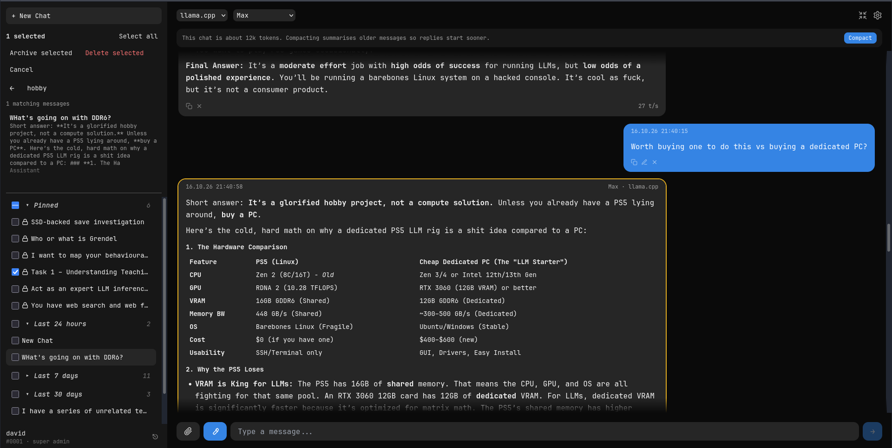

# Max

Max is a personal, opinionated fork of [Calivi](https://github.com/orkun-soylu/calivi), developed for practical local AI on modest hardware. Its maintainer selects components for usefulness, speed, low resource consumption, and straightforward operation rather than breadth of integrations.

The reference installation runs on **Ubuntu Linux with an NVIDIA RTX 3060 Laptop GPU (6 GB VRAM) and 16 GB system RAM**. It uses quantized models in the approximately **20B–80B parameter range**, with **Qwen3.6-35B-A3B APEX running on Buun** as the default.

These models are not necessarily fully GPU-resident. Quantization and CPU offloading are important to running them on this hardware. This configuration may be useful to others building local assistants on similarly constrained systems.

Max is based on Calivi v0.6.5 and adds its own interface, conversation management, execution tools, retrieval, and local-model workflow improvements.



## Reference architecture

- **Inference:** Buun (`b9637-3589-gd2407c33f`, commit `d2407c33f9595d1badccfd9a82a33c4c5ceda490`) serving Qwen3.6-35B-A3B APEX through an OpenAI-compatible endpoint. The inference server and model weights are managed separately from Max.
- **Execution:** OpenHands agent-server in Docker, with a persistent workspace and five tools: `sandbox_exec`, `sandbox_edit`, `sandbox_write`, `sandbox_read`, and `sandbox_ls`.
- **Retrieval:** Custom `web_search` with enhanced snippets and `web_fetch` for readable page content. The host-side search service uses DuckDuckGo with Brave fallback, Camoufox, and Mozilla Readability.
- **Application:** Python backend, React frontend, bundled SearXNG, and Docker Compose.
- **Interface:** Desktop and mobile chat UI with grouped conversations, pinned chats, multi-selection, archiving, and full-history message search.

Sandbox operations intentionally run without per-call approval. They execute inside the OpenHands container, not directly on the host.

## Current stack

* Local AI chat backend
* Docker Compose deployment
* Calivi UI foundation
* Local web search and page retrieval
* Dedicated search service using Camoufox
* DuckDuckGo search with Brave fallback
* Mozilla Readability for page extraction
* Built-in `web_search` and `web_fetch` tools
* Configurable search timeout
* Context usage and conversation compaction inherited from current Calivi
* `max.sh` for managing the local stack and search service

## Requirements

- Linux (Ubuntu is the reference platform)
- Docker Engine and Docker Compose (`docker-compose` is used by `max.sh`)
- Python 3.13 for the host-side search service
- An OpenAI-compatible inference endpoint or supported Ollama server
- Camoufox, installed by `search_service/setup.sh`
- Sufficient resources for the chosen inference model; model weights and inference software are not bundled

## Installation

Clone the repository and enter the project directory:

```bash
git clone https://github.com/davidrutland/Max.git
cd Max
```

Copy the example environment file:

    cp .env.example .env

Generate a persistent session/encryption key:

    openssl rand -hex 32

Put the generated value in `CALIVI_SECRET_KEY` inside `.env`. Keep it private and backed up separately from the application database. Do not regenerate it on subsequent starts.

Optionally configure per-model system prompts:

    cp config/system_prompts.example.yml config/system_prompts.yml

This file is Git-ignored. Max can start without it.

Install the search-service environment:

```bash
./search_service/setup.sh
```

Build the Docker images:

    docker-compose build

Start Max:

    ./max.sh start

The frontend is available at `http://localhost:8090` with the default `CALIVI_PORT`.

The default Compose stack includes the frontend, backend, SearXNG, and OpenHands sandbox. The host-side search service is managed by `max.sh`.

Configure your model endpoint through Max's server settings. **Buun, the inference model, and its weights are external dependencies**, not installed by this repository.

The OpenHands workspace persists in the `openhands-workspace` Docker volume. Sandbox commands and file operations run autonomously inside the container. The container is not network-disconnected and should not be treated as a complete security boundary against malicious code.

The optional stdio MCP bridge requires copying `stdio-bridge/servers.example.json` to `stdio-bridge/servers.json`, editing it, and enabling the `stdio-bridge` Compose profile. It is not needed for OpenHands.

The reference hardware describes one working installation, not a minimum specification. Fresh-clone deployment on other hardware has not yet been independently validated.

## Environment

The main configurable values are documented in `.env.example`.

Important settings include:

```text
CALIVI_PORT=8090
COOKIE_SECURE=false
CALIVI_SECRET_KEY=
CALIVI_SECRET_KEY_OLD=
OLLAMA_CHAT_TIMEOUT=300
SEARCH_TIMEOUT=15
```

`SEARCH_TIMEOUT` controls the timeout used by the backend when communicating with the local search infrastructure.

## SSD-backed conversation context (Buun)

### Why this exists

On memory-constrained systems, a long conversation may take a substantial time to **re-prefill**: the inference backend must process the entire prior conversation to rebuild its attention KV cache. Switching between conversations can repeat this work. After restarting the inference backend or rebooting the machine, its in-memory KV cache is gone, so every conversation would otherwise need re-prefilling when reopened. This is especially costly with large, partly CPU-offloaded models.

Max therefore supports saving Buun's live inference slot to **SSD** and restoring it later. The database remains the authoritative record of messages; saved KV state is a performance cache, not a replacement for chat history or a backup. Buun is used because it supports slot save/restore **and KV-cache compression**, making long contexts more practical on constrained hardware. Other backends may be integrated if they offer comparable persistence with better performance; **Buun is currently the only supported backend for Max SSD persistence**. A generic OpenAI-compatible endpoint is not sufficient.

### Configuration

Copy `.env.example` to `.env`, and configure the following for persistence. All settings below are included in `.env.example` and passed through by Compose as applicable.

| Setting | Purpose |
| --- | --- |
| `CONTEXT_PERSISTENCE_MODE=disabled` | Default; normal inference without SSD persistence coordination. Set `auto` to enable. |
| `CONTEXT_SNAPSHOT_TURN_INTERVAL=10` | Save after this many completed assistant turns; saving when a slot is displaced also applies. Must be at least 1. |
| `CONTEXT_SNAPSHOT_HOST_PATH=/path/to/your/snapshots` | Host directory for saved slots; must be the **same actual directory** used by Buun's `--slot-save-path`. |
| `CONTEXT_SNAPSHOT_CONTAINER_PATH=/context-snapshots` | Path where that host directory is mounted inside the Max backend container. |
| `BUUN_CONTEXT_URL=http://host.docker.internal:8080` | Example only: Buun router endpoint **as reachable from the backend container**; adjust to your Docker networking. |
| `BUUN_CONTEXT_MODEL=Max` | Example model alias; must match the model name advertised by the configured router. |
| `BUUN_BACKEND_IDENTITY=buun-local` | Stable administrator-chosen identifier for the same compatible backend installation; do not reuse for an incompatible backend. |
| `BUUN_CONTEXT_SERVER_ID=1` | Positive integer identifying the configured server in Max; use the correct server ID for your installation. |
| `BUUN_SLOT_SAVE_PATH=/context-snapshots` | Directory path **inside the Max backend container** for slot files. Compose sets this from `CONTEXT_SNAPSHOT_CONTAINER_PATH`; keep them equal. This is not the host-side path passed to Buun. |

`docker-compose.yml` already supplies the snapshot bind mount and forwards these values to the backend. The optional `docker-compose.context-snapshots.yml` is **not required** with the main Compose configuration. Ensure the host directory exists and is writable by both Buun and the Max backend container. Do not put snapshots into Git. `OLLAMA_CHAT_TIMEOUT` may need increasing for very long fresh prefills; it measures streaming silence, not total generation duration.

### Starting Buun

The reference installation starts **router mode** with a model preset file and one model worker at a time:

```bash
~/AI/buun-llama-cpp/build/bin/llama-server \
  --models-preset /home/david/AI/llama-models.ini \
  --models-max 1 \
  --models-autoload \
  --host 0.0.0.0 --port 8080 \
  --slot-save-path /home/david/AI/slot-snapshots
```

Replace the paths with your own. The snapshot path must match `CONTEXT_SNAPSHOT_HOST_PATH` in `.env`. The preset file must configure the model(s), their aliases, and their inference settings; it is external to this repository. Configure Max's model endpoint and `BUUN_CONTEXT_MODEL` to match the selected router model. Models must be loaded before restoring their slot state.

Buun can also be launched as a **direct, single-model server**:

```bash
~/AI/buun-llama-cpp/build/bin/llama-server \
  --model /path/to/model.gguf \
  --host 0.0.0.0 --port 8080 \
  --slot-save-path /path/to/slot-snapshots
```

Add model-specific context, GPU offload, CPU MoE offload, flash-attention and KV compression options appropriate to your model and hardware. This is a basic Buun startup example, **not a claim that Max's current SSD coordinator has been validated in direct mode**: the inspected startup code currently constructs a router transport and requires router-related settings. Ordinary non-persistent inference may use a directly loaded endpoint.

### Operation and compatibility

In `auto` mode, Max restores a compatible saved slot when switching back to a conversation, and saves live context on displacement and at the configured completed-turn interval. If a checkpoint is missing or invalidated, Max reconstructs context from database messages through the normal generation path; the first response may consequently be slow. Saving to SSD incurs disk space and I/O, so choose a sensible interval.

Changing the selected **model name**, effective system prompt, or available tools can invalidate the saved context. Max warns with **Continue / Fork / Cancel**: Continue keeps the conversation but rebuilds with the new configuration and replaces the prior checkpoint; Fork creates an independent conversation and checkpoint while retaining the original; Cancel leaves the existing conversation unchanged. These are user choices, not forced forks. Editing or deleting user/assistant messages invalidates affected checkpoint state and uses normal message regeneration rather than a separate prefill system.

In `disabled` mode, normal chat remains available without SSD coordination or configuration-change warnings. Changes made in this mode must not later restore an outdated checkpoint when persistence is re-enabled.

### Caveats and warnings

- **Use the tested Buun build** (reference commit above) or explicitly verify save, restore, erase, and compressed-KV compatibility before enabling `auto`. Other llama.cpp forks and generic OpenAI-compatible servers are not automatically compatible.
- **Model identity is name-based**, not a weights/tokenizer hash. The administrator must not silently replace a model behind the same name with incompatible weights or settings. Preserve the actual model and KV configuration needed to restore a checkpoint.
- Keep snapshot files on persistent, writable storage shared by the host inference process and backend container. A Docker container path is **not** the same as a host path; both must resolve to the same files. Ensure sufficient free disk space and permissions.
- SSD snapshots are caches, not durable message backups. Back up the Max database separately. A missing snapshot is recoverable by re-prefilling; a missing database is not.
- Avoid changing Buun builds, model definitions, context/KV settings, or snapshot ownership behind an existing checkpoint. When uncertain, invalidate/rebuild rather than attempting to restore incompatible state.
- The reference setup uses a single persistence owner/worker and one active model worker. Do not assume multi-worker, multi-process, or concurrent slot ownership is safe without additional verification.
- Long prefills can still occur after configuration changes, edits, missing checkpoints, or restarts when no valid saved state exists. SSD persistence reduces repeated work; it does not eliminate prefill entirely.

### Checkpoint restore failure

If Buun rejects a saved KV checkpoint during restoration, Max attempts
to erase the affected slot, marks the checkpoint as absent in SQLite,
and deletes the failed checkpoint file. Generation then proceeds using
the stored conversation history, rebuilding context as necessary.

The next response may take longer, but stored conversation messages
remain intact. If the slot cannot be safely erased, Max stops rather
than running inference with potentially invalid KV state.

Recovery is automatic and does not currently display a separate
notification in the chat interface.

Checkpoint files can consume substantial disk space. Development and
interrupted operations may leave unreferenced files in the configured
snapshot directory. Check database bindings and other Buun consumers
before deleting checkpoint files manually.

## Search

Max's search path uses the local `calivi-search` integration and the host-side `search_service`.

`search_service` provides the actual search-engine access:

* DuckDuckGo is the primary search engine.
* Brave is used as a fallback.
* Search results are normalised and deduplicated.
* Retrieved pages can be extracted using Mozilla Readability.

The built-in `web_search` tool uses the configured `calivi-search` engine.

`web_fetch` provides direct page retrieval through the local search service and is intended for fetching and extracting the contents of a specific URL.

The search service runs separately from the Docker containers on port `8787` and is managed by `max.sh`.

## Conversation search

Max includes a deterministic search facility for finding messages across
stored conversations. This is separate from the web-search and page-retrieval
tools described above.

Search supports:

- Keywords and exact phrases in double quotes.
- Boolean `AND`, `OR`, and `NOT`, including parentheses for grouping.
- Implicit AND between adjacent terms.
- `+` for required terms, `-` for exclusions, and `|` for OR.
- Prefix wildcard matching and technical search terms containing punctuation.

Search is lexical rather than semantic: it does not use an LLM to interpret
queries or generate results.

### Interface

The sidebar Search control is available on desktop and mobile.

- Results appear as the query is entered, after a short debounce.
- Each result identifies its conversation and shows a matching message excerpt.
- Results and the conversation list have independent scrolling areas.
- Selecting a result opens its conversation and jumps to the exact message.
- The selected message is temporarily highlighted.
- Repeated jumps within an already-open conversation are supported.
- Back closes search without changing the currently open conversation.

### Implementation

The authenticated backend endpoint is:

`GET /api/search/messages?q=...&limit=50&offset=0`

Results are scoped to conversations owned by the authenticated user.
The response includes a total match count and paginated message-level
results with conversation and message identifiers.

The current implementation evaluates queries against stored messages using
a user-scoped database scan. It does not require an FTS index or database
migration.

Conversation search does not call an inference model, load a model context,
or activate a conversation's saved inference state.

## Managing Max

The `max.sh` wrapper manages both the Docker Compose stack and the local search service.

```bash
./max.sh start
./max.sh stop
./max.sh restart
./max.sh status
```

The search service is only stopped by the wrapper when it is the process that the wrapper started.

Runtime logs are stored under:

```text
search_service/logs/
```

## Context and compaction

Max currently uses the context handling and conversation compaction functionality absorbed from the current Calivi codebase during the rebase onto v0.6.5.

The UI exposes context usage and the available compaction controls. Compaction is part of the current Max implementation rather than a future roadmap item.

Further context-management work may build on this foundation, particularly around preserving useful information from long conversations.

## Development

The backend is a Python application and the frontend is a Vite/React application.

Backend code:

```text
backend/
```

Frontend code:

```text
frontend/
```

Search service:

```text
search_service/
```

SearXNG configuration retained in the repository is supporting infrastructure for the Calivi stack and is not the logical Max search interface.

Build the frontend/backend containers with:

```bash
docker-compose build
```

Start the stack with:

```bash
./max.sh start
```

## Upstream relationship

Max is an independent downstream project.

Calivi is treated as an upstream source of useful fixes, features, and ideas. Upstream changes may be selectively incorporated when they fit Max's architecture and goals.

Max does not attempt to remain a patch-for-patch copy of Calivi.

See [`UPSTREAM.md`](UPSTREAM.md) for the fork point and porting policy.

## Roadmap

### UI

* Continue rebuilding Max's UI on the current Calivi foundation
* Restore and improve Max-specific UI features where useful
* Continue improving desktop and mobile usability

### Context and conversation

* Build further on the current compaction system
* Improve handling of very long conversations
* Preserve important decisions, facts, and unresolved questions during future context-management work
* Explore persistent memory where appropriate

### Retrieval

* Continue improving search quality and source selection
* Improve page extraction and retrieval reliability
* Reduce unnecessary search/tool calls

### Tools

* Expand useful local tools
* Improve tool selection and execution
* Keep tool interfaces simple and model-friendly

### Local AI

* Continue optimising Max for self-hosted local models
* Keep external dependencies and unnecessary cloud services to a minimum
